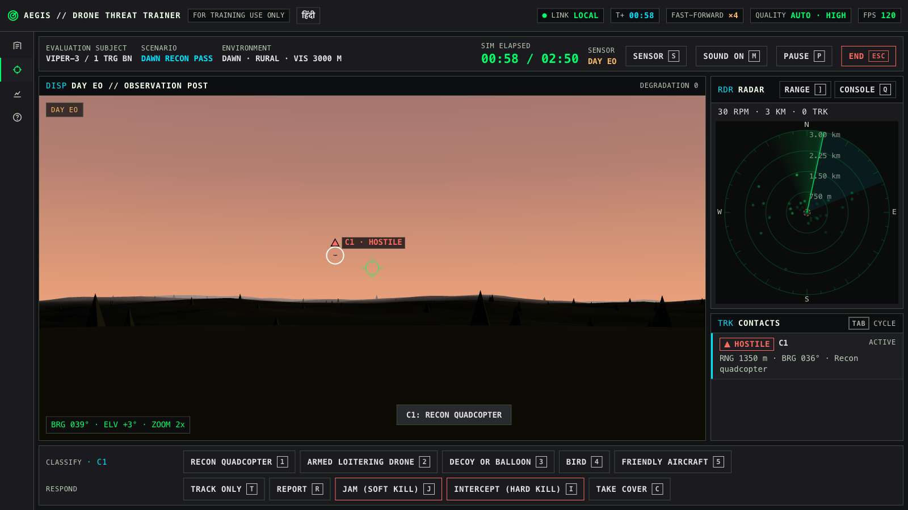
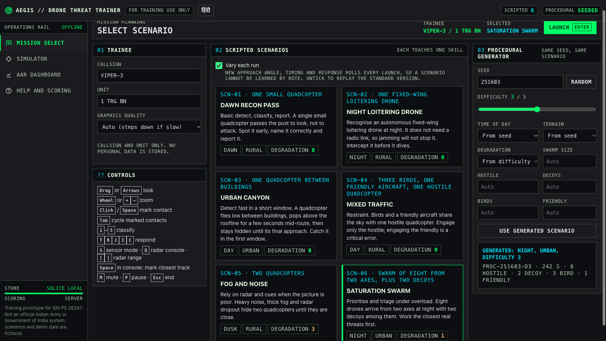
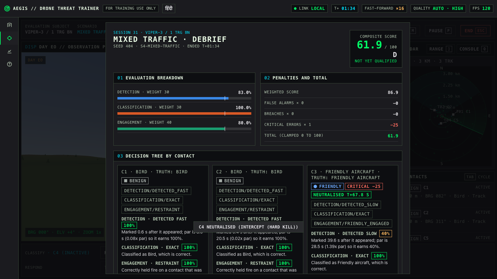
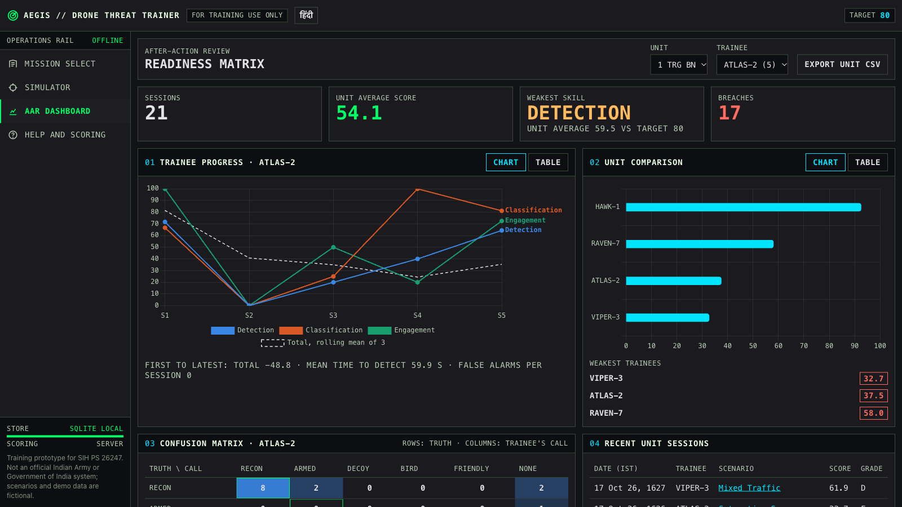
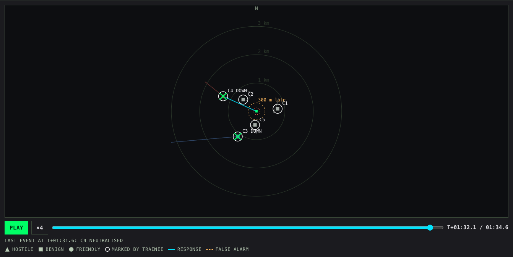
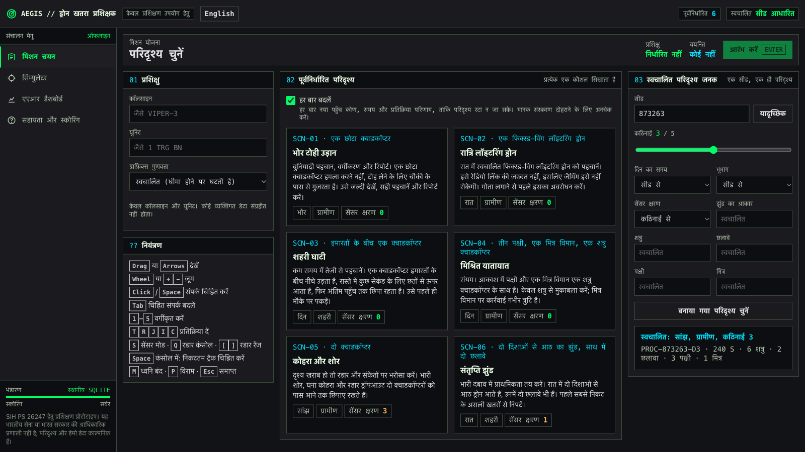

# AEGIS // Drone Threat Trainer

**Smart India Hackathon, problem statement 26247 · Theme: Drone Defence**

A browser-based 3D simulator that trains unit-level personnel to recognise, classify and respond to drone and swarm threats. Every session is scored on the server by an explainable decision tree, and an after-action review (AAR) dashboard tracks trainees and units over repeated sessions. It runs fully offline on an ordinary laptop, and a hosted version is online.

**Live demo: https://drone-sim-platform.vercel.app** · [Demo video (2 min)](https://github.com/ammar-iitm/drone-sim-platform/releases/download/v1.0-sih/aegis-demo.mp4) · English and हिंदी · [Run it locally](#install-and-run) · [MIT licence](LICENSE)



| Mission select | Score screen with decision-tree reasons |
| --- | --- |
|  |  |
| **AAR dashboard** | **Replay of a session** |
|  |  |

## Features at a glance

- **Simulator:** a 3D observation post with day, dawn, dusk and night lighting; urban and rural terrain; EO, night-vision and thermal sensors; four levels of sensor degradation (noise, fog, shorter range, radar dropout); a 30 RPM surveillance radar with clutter, false returns and track latency; and audio cues.
- **Threats:** recon quadcopters, armed hexacopters and fixed-wing loitering drones, with birds, decoy balloons and a friendly aircraft to tell apart; swarms of up to 12 that fly in formation and spread out when engaged.
- **Decisions:** mark, classify (5 classes) and respond: Track only, Report, Jam (soft kill), Intercept (hard kill) or Take cover. Everything works by mouse or keyboard.
- **Scenarios:** six scripted scenarios, each with a learning objective, plus unlimited procedural scenarios from a seed. Difficulty runs from 1 to 5, and every run is a fresh variant, so trainees cannot learn a scenario by rote.
- **Explainable scoring:** detection time, classification accuracy and engagement decisions are scored by a decision tree in an editable `rubric.json`. Every point shows its tree path and a plain-language reason. Rules are checked against the US Army's public C-UAS manual, ATP 3-01.81 (2025).
- **After-action review:** trainee trends, unit averages, weakest skill and weakest trainees, a confusion matrix, CSV export, and a top-down replay of every session.
- **Built for Indian users:** a हिंदी / English switch, dates in IST, accessibility per GIGW (WCAG 2.1 AA contrast, a skip link, keyboard-only play), and a clear disclaimer that it is a training tool.
- **Runs anywhere:** a browser and Python on an ordinary laptop, offline after the first install. Graphics quality steps down by itself on weak machines.
- **Works on phones for review:** the dashboard, session replays and help read cleanly on a phone; the simulator itself needs a keyboard and mouse and says so.
- **Optional instructor login** for the hosted version: results can be restricted to instructors while trainees keep playing. It's off for now.



## Problem statement (SIH PS 26247)

The official statement asks for a software platform that trains personnel to recognise, classify and respond to drone and swarm threats across day and night, degraded sensors, urban and rural terrain, and single-drone and swarm attacks, usable at unit level with minimal specialised hardware. Its four expected outcomes, and where each is met:

| Expected outcome | How the trainer meets it |
| --- | --- |
| Desktop or VR-capable simulator with scripted and procedurally generated threat scenarios | Browser 3D simulator (Three.js) with six scripted scenarios, each with a learning objective, and a seeded procedural generator. Desktop only; the statement accepts desktop **or** VR |
| Decision-tree based scoring on detection time, threat classification accuracy and engagement decisions | Server-side decision tree from `rubric.json`; every score shows its tree path and a reason |
| After-action review (AAR) dashboard tracking individual and unit performance over repeated sessions | `/dashboard`: trainee trends, unit rollup, weakest skill and trainees, confusion matrix, CSV export, and a top-down replay of every session |
| Adjustable difficulty and scenario randomization to prevent rote learning | Difficulty 1–5 scales speed, counts, decoys and degradation together. The procedural seed is random on every visit, and scripted scenarios launch as a seeded variant by default (**Vary each run**) |

The rest of the statement is covered too:
- **Drone types:** commercial quadcopters and hexacopters, and a military-grade fixed-wing loitering drone.
- **Distractors:** birds, balloons used as decoys, and a friendly aircraft.
- **Conditions:** day, dusk and night; EO, night vision and thermal; four sensor degradation levels with fog, noise and radar dropout; urban and rural terrain.
- **Attacks:** single drones and swarms of up to 12.
- **Hardware:** it runs offline in a browser on an ordinary laptop.

## Install and run

You need Python 3.10 or newer and a current Chrome, Edge or Firefox. The first start needs internet once to install Flask; after that everything runs offline. Three.js and Chart.js are bundled in `app/static/vendor/`, and the pages use system fonts.

**One command** (creates `.venv` on the first run, then opens the browser at http://localhost:5050/mission):

```bash
./start.sh              # macOS or Linux
./start.sh --demo       # also seed a demo cohort (6 trainees, 2 units, 30 scored sessions) if there is no database yet
```

```bat
start.bat               :: Windows (double-click works too)
start.bat --demo
```

**By hand:**

```bash
python3 -m venv .venv
.venv/bin/pip install -r requirements.txt        # Windows: .venv\Scripts\pip install -r requirements.txt
.venv/bin/python run.py                          # Windows: .venv\Scripts\python run.py
```

Options:

```bash
.venv/bin/python scripts/seed_demo.py --reset    # reset the database to the demo cohort
DATABASE_URL=<postgres url> .venv/bin/python scripts/seed_demo.py --reset   # same, for a hosted database
.venv/bin/python run.py --port 8000 --lan        # expose on the local network (no login; trusted networks only)
NO_BROWSER=1 ./start.sh                          # start without opening a browser
.venv/bin/python scripts/package.py              # build dist/drone-threat-trainer-<date>.zip to copy to another machine
```

**Graphics quality.** On a slow laptop, choose **Graphics quality** on Mission select:
- **Auto** (the default) starts at High and steps down if the frame rate stays under 35 fps for 3 seconds.
- **Low** renders at 0.75× resolution with no antialiasing and draws only the nearest 35% of scenery.
- **Minimum** (for the weakest graphics) renders at 0.5× resolution and draws the nearest 20% of scenery. Auto steps down to it as a last resort.

You can also add `&quality=low` to a simulator URL.

**If a save fails.** If the server is unreachable when a session ends, the session is kept in the browser. Mission select then offers to send it once the server is back.

## Using it

1. **Mission select** (`/mission`): enter a callsign and unit. Pick one of the six scripted scenarios, or set seed, difficulty, time of day, terrain, degradation, swarm size and threat mix for a procedural one. Then press **Launch**.
   - **Vary each run** (on by default) launches a scripted scenario as a seeded variant: every approach turns by the same angle (up to 30°), spawn times shift, and response rolls change, so trainees cannot learn it by rote. The learning objective stays the same. Untick it to replay the standard version. A variant is reproducible from its number (`/sim?id=s1-dawn-recon&vary=4242`).
   - The procedural seed starts on a new random value on every visit.
2. **Simulator** (`/sim`): read the briefing, press **Enter**, and work the threats.

   | Input | Action |
   | --- | --- |
   | Drag or arrow keys | Look |
   | Wheel or `+` / `-` | Zoom 1x, 2x, 4x, 8x |
   | Click, or `Space` at the reticle | Mark a contact (empty sky is a false alarm) |
   | Click a radar track | Mark that track |
   | `Tab` / `Shift+Tab` | Cycle marked contacts |
   | `1` to `5` | Classify: Recon quadcopter, Armed loitering drone, Decoy or balloon, Bird, Friendly aircraft |
   | `T` `R` `J` `I` `C` | Respond: Track, Report, Jam, Intercept, Take cover |
   | `S` | Sensor mode: day EO, night vision, thermal |
   | `Q` | Radar console: full-screen scope plus track table |
   | `[` / `]` | Radar range 1.5, 3 or 6 km |
   | `Space` in the console | Mark the closest unmarked radar track |
   | `M` | Mute or unmute the audio cues |
   | हिंदी / English button | Switch the interface language (remembered per browser) |
   | `P` / `Esc` | Pause / end the session |

3. **Score screen**: shows the composite score, grade, stage bars and the decision-tree path with a reason for every contact. **Run same seed again** replays the identical scenario, including the same variant of a scripted one.
4. **Help and scoring** (`/help`): controls, threat markers, sensors and radar, and the full scoring tree drawn live from `rubric.json`.
5. **AAR dashboard** (`/dashboard`): shows the unit overview, trainee progress (with a table view), unit comparison, confusion matrix and session log. Each session links to its review.
6. **Session review** (`/dashboard/session/<id>`):
   - **Replay:** a top-down map of the whole engagement, showing every contact's true identity and track, the trainee's marks (white rings), responses (cyan lines from the post), false alarms (amber rays), and where each drone was stopped or breached. It has play/pause (**Space**), speed ×1/×4/×16 and a time scrubber.
   - **Event timeline:** clicking an event jumps the replay to that moment.
   - **Score detail:** stage scores, penalties and the decision tree for every contact.

## Hosted version (Vercel)

Live at **https://drone-sim-platform.vercel.app**. It's public. The instructor login is built but **turned off for now** (see below).

- **Hosting:** the Vercel project `drone-sim-platform` on team `the-layers`, running as one Flask function in `iad1` (US East). `index.py` is the entrypoint.
- **Database:** Neon Postgres from the Vercel Marketplace (`drone-trainer-db`). Neon sets `DATABASE_URL` on the project. When `DATABASE_URL` is set the app uses Postgres (`app/schema_pg.sql`); otherwise it uses the local SQLite file, so the laptop version stays fully offline. Queries are written once; `app/db.py` translates them for Postgres.
- **Deploying:** run `npx vercel deploy --prod` from the repo root. The project is **not** connected to GitHub, so pushing doesn't deploy. `.vercelignore` keeps tests, archive, screenshots and local data out of the upload.
- **Testing on Postgres:** `TEST_DATABASE_URL=<url> .venv/bin/python -m pytest tests --ignore=tests/e2e` runs the Python tests on Postgres. The test tables are dropped before every test, so point it at a throwaway database (for example, run `CREATE DATABASE trainer_test` in the Neon project and use that URL), **never** the live `neondb`.
- **Sidebar labels:** the sidebar and simulator show **Hosted / Postgres hosted** instead of **Offline / SQLite local**.
- **Instructor login (optional, off for now):** to turn it on, set `INSTRUCTOR_PASSWORD` as a Vercel environment variable (`npx vercel env add INSTRUCTOR_PASSWORD production`) and redeploy. `SECRET_KEY` is already set on the project. To turn it off again, remove the variable and redeploy.
  - With it set, the dashboard, session reviews, CSV exports and the results APIs need an instructor login (`/login`); trainees can still choose a scenario, play and see their own score.
  - Without it, everything stays open, as on an offline laptop.
  - The session cookie is signed with `SECRET_KEY`. If that isn't set, a key is derived from the password, so changing the password signs everyone out.

## Editing the rubric

All scoring numbers live in [`rubric.json`](rubric.json). The next session is scored with whatever the file says, with no code change or restart. Each key controls:

| Key | Controls |
| --- | --- |
| `weights` | Stage weights (default 30 detection, 30 classification, 40 engagement) |
| `detection_tiers` | Points by time-to-detect as a multiple of the contact's par time |
| `classification_scores` | Exact, same family, wrong family |
| `engagement_scores` | Correct and effective, correct but failed roll, late or unsuitable, none or breach, restraint, unnecessary engagement |
| `penalties` | False alarm (and cap), breach, critical error |
| `grade_bands` | Minimum total for each grade |
| `geometry` | Inner ring radius (breach), "late" range, mark tolerance |
| `classes` | Class labels, families and hot keys; `critical_misclassification` says which wrong calls are critical |
| `responses` | Labels, hot keys, whether a response engages, range limits and effectiveness per drone model |
| `expected_responses` | Suitable responses per model (a scenario contact can override this) |
| `passive_responses` | Responses credited when a hostile stays beyond the reach of every suitable response (Take cover) |

The browser never sends a score. It sends raw events (`mark`, `classify`, `respond`, `sensor`, `breach`), and the server rebuilds the scenario from its id (and variant number) or seed and scores it. Response success rolls come from the scenario seed (`app/rng.py`, mirrored in `app/static/js/sim/rng.js`), so the result is reproducible.

## Folder layout

```
app/
  __init__.py        Flask app factory
  auth.py            Instructor login (only when INSTRUCTOR_PASSWORD is set)
  api.py             JSON API (scenarios, rubric, trainees, sessions, analytics)
  views.py           Pages: /mission, /sim, /dashboard, /dashboard/session/<id>, /help
  scenario.py        Seeded generator: scripted + procedural scenarios, difficulty table
  scenarios/*.json   The six scripted scenarios (waypoints as bearing, range, altitude)
  scoring.py         Decision-tree scoring: a pure function of scenario, events and rubric
  geometry.py        Contact paths (shared maths with static/js/sim/path.js)
  rng.py             Seeded rolls (bit-identical with static/js/sim/rng.js)
  analytics.py       Trends, confusion matrix, unit rollup
  db.py, schema.sql  Storage: SQLite (data/trainer.db) by default; Postgres (schema_pg.sql) when DATABASE_URL is set
  templates/         Pages in the AEGIS (Stitch) style
  static/css/        aegis.css (design system), sim.css (HUD)
  static/js/sim/     Simulator: world.js (Three.js scene), radar.js, main.js (loop, input, HUD)
  static/js/         mission.js, dashboard.js, session.js, replay.js (AAR replay map), help.js, results.js
  static/vendor/     Three.js 0.186.1, Chart.js 4.5.1 (with licences)
rubric.json          Editable scoring rubric
run.py               Start the app (start.sh / start.bat wrap it with first-run setup)
index.py             Vercel entrypoint (hosted version)
scripts/seed_demo.py Seed a demo cohort through the real API
scripts/package.py   Build a clean zip to copy to another machine
tests/               pytest: generator, scenario variants, scoring tree, API, offline check, JS/Python roll parity
tests/e2e/           Browser tests (Playwright with the installed Chrome); screenshots go to test-results/
archive/             Earlier Antigravity prototype (Node/React/Unity) and the original Stitch screens
docs/                PRD, AVD and Visual Design specs; rubric sources (ATP 3-01.81 review); img/ README screenshots
data/                SQLite database (created on first run, not committed; delete to reset)
```

## Tests

```bash
.venv/bin/pip install -r requirements-dev.txt         # once: pytest and Playwright (the browser tests drive the installed Chrome)
.venv/bin/python -m pytest tests --ignore=tests/e2e    # Python tests, under a second
.venv/bin/python -m pytest                              # all 207, about 6 minutes
TEST_DATABASE_URL=<postgres url> .venv/bin/python -m pytest tests --ignore=tests/e2e   # same tests on Postgres
```

The browser tests block every non-local request, so they also check that nothing is fetched from the internet.

## Status (2026-10-16)

- **Requirements:** 19 of the 21 PRD requirements are verified by tests or screenshots. Two are partial:
  - **F8 audio:** every cue and the mute key are tested in code, but nobody has listened yet (issue #11).
  - **F9 VR:** not built, by decision; rendering is isolated in `world.js` so it can be added later.
- **Tests:** 207 pass: 164 Python tests and 43 browser tests. The browser tests play all six scenarios end to end, both standard and varied.
- **Offline:** verified. Every browser test blocks non-local requests, and a full run with Wi-Fi off was done by hand on 2026-10-06.
- **Target laptop:** MacBook Pro (Mac17,9), Apple M5 Pro (15-core CPU, 16-core GPU), 24 GB, macOS 27.0.1, Chrome 155.0.8059.39.
  - **12-drone swarm:** 120 fps on both Auto and Low quality at 1920 × 1080. That is the display's refresh cap.
  - **Launch to first scenario:** 0.7 s with `.venv` already built; 5.4 s from a fresh clone, where `start.sh` builds `.venv` and installs everything first. The target is under 60 s.
  - Both were measured on 2026-10-10 by a script driving a visible Chrome window.
- **Low-end laptops (simulated on 2026-10-16, issue #10):** a real low-end laptop hasn't been tested yet, so Chrome was forced onto software rendering, which is slower than any integrated graphics.
  - The 12-drone swarm ran at 15–23 fps.
  - The same page with the 3D scene hidden still topped out at about 33 fps, so the limit is software rendering's fixed cost for any page, not the trainer's scene (3 draw calls, 13,000–47,000 triangles).
  - A 6× slower CPU made no difference on a real GPU (still 120 fps).
  - 30 fps on real integrated graphics is therefore likely, but must still be confirmed on a real machine. A **Minimum** quality level was added as an extra fallback.

## Decisions

| Date | Decision |
| --- | --- |
| 2026-10-07 | **Stack:** Flask and SQLite on the server; Three.js and Chart.js vendored, with no CDN |
| 2026-10-07 | **Look:** Stitch "AEGIS" dark theme only. This deliberately departs from the Visual Design doc's light dashboard |
| 2026-10-07 | **Text:** data text is at least 14 px; only captions are 12 px (enforced by `test_access::test_text_sizes`) |
| 2026-10-07 | **Desktop only.** No VR in this release |
| 2026-10-07 | **Grade bands:** A ≥ 90, B ≥ 80, C ≥ 70, D ≥ 60, otherwise F |
| 2026-10-07 | **No demo is scheduled** |
| 2026-10-10 | **No zip submission.** `scripts/package.py` still builds one if it is ever needed |
| 2026-10-10 | **Target laptop:** the MacBook Pro listed under Status |
| 2026-10-10 | **Team:** Ammar owns every track and reviews merges |
| 2026-10-10 | **Hosted on Vercel** with Neon Postgres, public link, no login. Local and offline use stays on SQLite |
| 2026-10-16 | **Scoring decisions** for issue #15, listed below |
| 2026-10-16 | **AAR replay** added to the session review, and **instructor login** added (off unless `INSTRUCTOR_PASSWORD` is set) |
| 2026-10-16 | **Hindi:** a हिंदी / English switch in the header (GIGW bilingual content; the Indian Army site uses the same pattern). The choice is remembered per browser. It covers the interface, scenario names and objectives, threat classes, responses, the dashboard and score explanations. The longer Help prose stays in English. The translation should be reviewed by a Hindi-speaking instructor before formal use (`app/static/js/i18n-hi.js`) |
| 2026-10-16 | **Rubric version 2 (issue #14):** Take cover scores 100% when the hostile stays beyond reach of every suitable response, and Jam and Intercept are renamed "soft kill" and "hard kill" |
| 2026-10-16 | **Indian conventions:** the banner reads "For training use only" instead of the US-style "Unclassified //" (India's scheme is Top Secret, Secret, Confidential, Restricted). Dates show in IST with the 24-hour clock ("10 Oct 2026, 0945 hrs IST"); CSV exports keep UTC. The page language is `en-IN`, with a GIGW-style "Skip to main content" link and a disclaimer that this is not an official Indian Army or Government of India system. Demo units are fictional ("1 TRG BN", "2 TRG BN") instead of real battalions |
| 2026-10-16 | **Dawn lighting** for Dawn Recon Pass, which ran at dusk before. It's for scripted scenarios only, so procedural seeds are unchanged |
| 2026-10-17 | **Instructor login is optional and off for now** on the hosted version; the feature stays in the code and can be turned on with one environment variable |

## Scoring decisions (issue #15, agreed 2026-10-16)

| # | Rule | Decision |
| --- | --- | --- |
| 1 | A correct, timely response that fails its success roll keeps 60% of the engagement points, even if the drone then breaches. The 10-point breach penalty still applies | **Kept.** The AVD says a trainee is not punished for bad luck |
| 2 | Decoys are non-threats: scored only if marked, and engaging one is an unnecessary engagement (0%) | **Kept.** Decoys exist to waste defences |
| 3 | "Late" means engaging inside 300 m | **Kept, as a team choice.** At difficulty 5 a fixed-wing covers the last 300 m in about 4 s, against about 9 s for a quadcopter. A time-to-impact rule may be fairer later |
| 4 | Suitable responses: jam or intercept for quadcopters and hexacopters; intercept only for fixed-wing drones | **Kept.** Matches public sources (electronic defeat for small drones, kinetic for pre-programmed ones) |
| 5 | Swarm members are counted on top of the difficulty table's hostile count | **Kept.** The AVD lists them as separate columns |
| 6 | Take cover or Report against a hostile scores 20% (unsuitable) | **Kept for Report; refined for Take cover in row 8** |
| 7 | A suitable first response that fails its roll, followed by a retry that stops the drone before the 300 m line | **Changed: now scores 100%** (it was 60%). Persisting should beat giving up. A retry inside 300 m keeps 60%, and an unsuitable first choice stays 20% even if a later response works |
| 8 | Take cover against a hostile that then stays beyond the reach of every suitable response (issue #14, from ATP 3-01.81) | **Changed: now scores 100%.** If the drone later comes within reach, cover alone stays 20% |
| 9 | Response names (issue #14) | **Renamed:** "Jam (soft kill)" and "Intercept (hard kill)", the terms in India's counter-drone guidelines |

## Spec differences (issue #16, checked 2026-10-16)

The original PRD, AVD and Visual Design docs were read against the running app. Each difference is either fixed or a deliberate choice:

| Spec says | App does | Status |
| --- | --- | --- |
| PRD: Dawn Recon Pass is at dawn | It ran with dusk lighting and showed a DUSK tag | **Fixed:** new dawn lighting (pinker, sun in the east) |
| PRD: three expected outcomes | The official statement has four; the fourth is adjustable difficulty and randomisation | **Covered:** random seeds and scripted variants (see Problem statement) |
| PRD: sessions stored in SQLite | SQLite offline; Postgres when hosted | **Deliberate** (hosted version) |
| PRD non-goal: no VR | No VR | As specified |
| AVD: radar updates "about once per second" | The radar sweeps at 30 RPM, so each track updates every 2 s, with clutter, false returns and 2-of-3 track initiation | **Deliberate:** a more realistic radar model; tested |
| AVD: quadcopters can hover | Drones fly their waypoint paths at constant speed, with seeded wobble | **Simplification**, kept |
| AVD: session review lists the decisions | Event timeline plus a visual replay | **Exceeded** |
| AVD: add instructor login before any shared deployment | Instructor login exists (off unless a password is set) | **Done** |
| Visual Design: light dashboard theme, blue accent palette | Stitch "AEGIS" dark theme with green and cyan accents | **Deliberate** (decision of 2026-10-07) |
| Visual Design: threat markers pair colour, shape and label | Triangle, diamond, circle and square, each with a text label, in the simulator and the replay | As specified |

## Known limits and risks

- **This is a decision-training aid, not a weapons simulator.** Responses are abstract categories with configurable effectiveness. There is no ballistic or countermeasure modelling.
- **The rubric numbers are team choices.** The structure follows public counter-drone principles, but no public source gives the weights (30/30/40), detection tiers, penalties (2/10/25), grade bands or the 300 m "late" range. Say so if asked, and don't cite doctrine for them. Instructors can edit all of them.
- **The target laptop is fast.** 120 fps on an M5 Pro says little about the PRD baseline (integrated GPU, 8 GB RAM). An earlier run reached only 30 fps with 8 drones, before quality levels existed. On weaker machines, Auto lowers the quality by itself; measure there before relying on it.
- **`start.bat` has never run on Windows.**
- **The cold-start times had pip's download cache warm.** A truly fresh machine will be slower on the first install. `start.sh` needs Python 3.10 or newer and refuses macOS's built-in 3.9 with a clear message.
- **Scoring needs the server.** If the server is down when a session ends, the session is kept in the browser and offered for resending on Mission select.
- **Identity:** trainees are identified by callsign and unit only.
- **`--lan` mode has no login.** Use it only on a trusted network.
- **The hosted version's results are public while the instructor login is off** (the current setting). Anyone with the link can read the dashboard and CSV exports, so keep real personnel data off it. Trainee play stays open by design, so anyone can add sessions. When the login is on, it adds a 0.5 s delay after a wrong password but has no lockout.
- **Hosted latency:** every request opens a new database connection to Neon, and Neon's free tier sleeps when idle. The first request after a quiet spell takes a second or two longer.
- **Visual effects are not scored.** Swarm separation and wobble are drawn on top of each drone's path; the server always scores the clean path.

## What is left

Tracked as GitHub issues, all assigned to Ammar:

| Issue | Task |
| --- | --- |
| #10 | Install on a second machine using only this README, including the first-ever run of `start.bat` on Windows. Use an ordinary laptop with integrated graphics and confirm 30 fps with the 12-drone swarm (the simulated low-end test is under Status) |
| #11 | Human checks. Play any scenario with sound on: the rotor hum should rise as a drone closes in, the tick, chime, buzz and breach alarm should play on their events, and **M** should mute. Set macOS Display → Colour filters → Greyscale and check that the threat markers (triangle, diamond, circle, square, each with a text label) and the dashboard still read clearly. In Urban Canyon, the drone should show for about 4 s around T+37 s and again on final approach |
| #13 | Keep the full test suite passing on every merge (ongoing) |

## Contributing

Contributions are welcome. See [CONTRIBUTING.md](CONTRIBUTING.md) for setup, tests, commit style and the ground rules: a training aid, public sources only, no official branding, no real personal data, offline first.

## Licence

[MIT](LICENSE) © 2026 Ammar Hashmi. The bundled Three.js and Chart.js keep their own MIT licences in `app/static/vendor/`. This is a training prototype and is not an official Indian Army or Government of India system.
