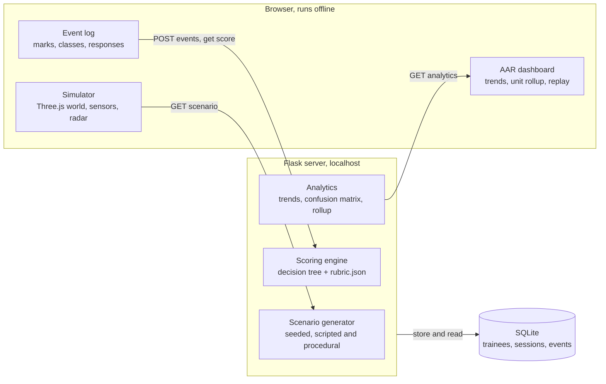

# SIH26247 Drone Threat Trainer: Architecture and Design (AVD)

Oct 6, 2026 · Ammar Hashmi

## Purpose and design principles

This document explains how the Drone Threat Trainer is built so that it meets the PRD while running on a laptop with no internet. It covers the architecture, the simulator, the scenario generator, the scoring engine, the data model and the build plan.

Six principles drive every decision:

- **Offline first.** Every library and asset is bundled with the project, and nothing is fetched at run time.
- **Minimal hardware.** A browser and Python are enough. There is no game engine to install and no GPU requirement beyond WebGL.
- **Deterministic by seed.** Scenario content comes only from the server-side generator, so the same seed always rebuilds the same scenario.
- **Explainable scoring.** Scoring is a pure function of the event log and the rubric, and it returns the decision-tree path behind every score.
- **Server owns the score.** The browser sends raw events and never a score, so results cannot drift between the simulator and the dashboard.
- **Separate modules.** Rendering, scenario generation, scoring and storage are independent, so each can be tested alone and a VR renderer could replace the desktop one later.

## System architecture



The simulator never scores itself: it sends the raw event log to the server, which scores it against the rubric, stores the result and feeds the dashboard.

## Technology choices

The stack is small and familiar, and everything in it can be bundled for offline use.

| Layer | Choice | Why |
| --- | --- | --- |
| 3D simulator | Three.js (WebGL), vendored as a local ES module | Runs in any current browser with no install, handles terrain and a 12-drone swarm at 30 fps, and leaves room for a WebXR mode later |
| Sensor effects | CSS filters on the canvas plus a 2D noise overlay | Cheap on integrated GPUs and needs no custom shader pipeline |
| Backend | Flask | Small, already familiar to the team, serves both pages and the JSON API |
| Storage | SQLite through the standard library | One file, no setup, enough for a unit's sessions |
| Scenario generator and scoring | Plain Python modules | Testable without starting a server |
| Dashboard charts | Chart.js, vendored locally | Works offline and renders accessible canvas charts |
| Tests | pytest, plus a Playwright smoke test of the simulator | Covers generation, scoring, the API and a real browser load |

## Simulation engine

The simulator runs a fixed-timestep world of contacts around one observation post, and renders it through a selectable sensor.

| Part | Design |
| --- | --- |
| World and terrain | The observation post sits at the origin, units are metres. Terrain is a height field built from seeded noise (rural) or a grid of seeded boxes (urban). The scenario supplies the terrain seed, so the same scenario looks the same every time |
| Contacts | Each contact has an id, a physical model (quadcopter, hexacopter, fixed-wing, balloon, bird, friendly aircraft), a true class, a threat level, a speed and a path |
| Flight behaviour | Contacts follow waypoints with seeded wobble. Quadcopters can hover and change heading; fixed-wing drones fly smooth arcs and dive at the end; birds flap erratically and often change direction; balloons drift |
| Swarm logic | Members follow a leader's path with formation offsets and a simple separation rule, so they stay in a loose group and spread out when engaged |
| Sensor modes | Day EO, night vision and thermal are produced by CSS filters on the render canvas. Degradation adds noise, fog and a shorter visible range, and fades distant contacts |
| Radar | A sweep updates contact tracks about once per second with positional noise and a dropout chance that rises with degradation. Radar shows range, bearing and a weak size cue, but never the true class |
| Controls | Mouse drag or arrow keys to look, wheel or keys to zoom, click to mark a contact, number keys to classify, hot keys to respond |
| Response model | Each response has an effectiveness value per contact model, from a configuration file, and a success roll made with the scenario's seeded generator. Jamming is weak against autonomous fixed-wing drones, interception works on all drones but is limited by range and speed |
| Game loop | Logic ticks at a fixed 30 Hz of scenario time, rendering runs at the display rate, and every trainee action is stamped with scenario time and appended to the event log |

A contact that reaches the inner ring without being neutralised produces a breach event, which ends that contact's story and counts against the session.

## Scenario generator

The generator is a Python module that turns a small set of parameters into a complete scenario, using a seeded random generator so the output is repeatable. Scripted scenarios are fixed parameter sets with hand-set contact lists, and procedural ones are generated.

Generation runs in four steps: choose the environment (time of day, terrain and its seed, fog, noise and radar dropout from the degradation level), choose approach axes, build the contact list for each class, then assign spawn times and paths.

Difficulty from 1 to 5 sets the other knobs together, so an instructor can move one slider:

| Difficulty | Hostile contacts | Swarm | Decoys and benign contacts | Sensor degradation | Speed vs baseline |
| --- | --- | --- | --- | --- | --- |
| 1 | 1 | No | 0 decoys, 1 benign | 0 | 1.0x |
| 2 | 2 | No | 1 decoy, 2 benign | 0 | 1.1x |
| 3 | 3 | Up to 3 | 2 decoys, 3 benign | 1 | 1.2x |
| 4 | 5 | Up to 5 | 3 decoys, 3 benign | 2 | 1.3x |
| 5 | 8 | Up to 8 | 4 decoys, 4 benign | 3 | 1.4x |

An instructor can still set the swarm size by hand up to 12.

A scenario is one JSON document, so the simulator, the scoring engine and the tests all read the same thing:

```json
{
  "id": "proc-48213-d3",
  "name": "Generated: night, urban, difficulty 3",
  "seed": 48213,
  "duration_s": 240,
  "environment": {
    "time_of_day": "night", "terrain": "urban", "terrain_seed": 91823,
    "fog": 0.2, "noise": 0.15, "radar_dropout": 0.08, "visual_range_m": 2200
  },
  "contacts": [
    {
      "id": "C1", "model": "quadcopter", "true_class": "RECON_UAS",
      "threat": "hostile", "spawn_t": 12, "speed_mps": 18,
      "waypoints": [[-1400, 90, 1200], [-200, 60, 100], [0, 30, 0]],
      "par_detect_s": 25, "swarm": null
    }
  ]
}
```

## Scoring engine

Scoring is a pure function: given a scenario, an event log and the rubric, it returns per-contact results with the decision-tree path and reason for each score, plus the session totals. The same inputs always give the same output, which makes it easy to test and to explain.

Each contact goes down the same three stages of the tree:

| Stage | Question asked | Outcomes |
| --- | --- | --- |
| Detection | Did the trainee mark this contact before it breached or left, and how fast against the par time? | Missed scores 0. Detected scores 100%, 75%, 40% or 10% of the stage as time to detect passes 0.5x, 1x or 2x of par |
| Classification | Did the trainee choose a class, and does it match the truth? | Exact match scores 100%. Right threat family but wrong type scores 50%. Wrong family scores 0, and calling a hostile contact benign or friendly raises a critical flag |
| Engagement | Was the response suitable for the true class, did it work, and was it timely? | For hostile contacts: a correct, timely response that works scores 100%, a correct choice that fails on the roll scores 60%, a late or unsuitable response scores 20%, no response or a breach scores 0. For benign contacts: restraint scores 100%, an unnecessary engagement scores 0, and engaging a friendly contact raises a critical flag |

Two details keep it fair. Engagement scores the decision before the roll, so a trainee who chose well is not punished for bad luck. And only hostile contacts must be detected; benign, decoy and friendly contacts are scored only if the trainee marks them.

Session totals combine the stage averages using the rubric weights (default 30 detection, 30 classification, 40 engagement) and then subtract penalties: 2 points per false alarm up to 10, 10 per breach and 25 per critical error. The total is clamped to 0 to 100 and mapped to a grade band. Every weight, threshold, penalty, expected response and effectiveness value lives in `rubric.json`, so an instructor can change them without touching code.

## Data model and API

Three tables hold everything: trainees, sessions and the raw events inside each session.

| Table | Key fields | Purpose |
| --- | --- | --- |
| trainees | id, callsign, unit, created_at | Who trained; callsign and unit only |
| sessions | id, trainee_id, scenario_id, scenario_name, seed, params (JSON), started_at, duration_s, total, detection, classification, engagement, grade, false_alarms, breaches, critical_errors, result (JSON) | One row per run, with the scored result stored for fast dashboards |
| events | id, session_id, t, type, contact_id, data (JSON) | The raw log: marks, classifications, responses, sensor switches, breaches |

The event log uses a small set of types: `mark` (contact id or empty for a false alarm), `classify` (contact id and chosen class), `respond` (contact id and response), `sensor` (mode change), and `breach` (contact reached the inner ring, written by the simulator).

| Endpoint | Method | Purpose |
| --- | --- | --- |
| `/api/scenarios` | GET | List scripted scenarios |
| `/api/scenario` | GET | Return a scripted scenario by id, or generate one from seed and parameters |
| `/api/rubric` | GET | Return the current rubric and response effectiveness |
| `/api/trainees` | GET, POST | List trainees, or add one |
| `/api/sessions` | POST | Submit an event log, score it, store it and return the result |
| `/api/sessions` | GET | List sessions, filtered by trainee or unit |
| `/api/sessions/<id>` | GET | One session with its event log and per-contact tree paths |
| `/api/analytics/trainee/<id>` | GET | Trend series, averages and confusion matrix for one trainee |
| `/api/analytics/unit/<unit>` | GET | Unit averages, weakest skill and weakest trainees |

## AAR dashboard

The dashboard answers three questions: how is this trainee improving, where does the unit fall short, and what exactly happened in this session. It reads precomputed results from the database, so it loads quickly even offline.

| View | What it shows | Source |
| --- | --- | --- |
| Unit overview | Session count, unit average per metric, the weakest skill, the three weakest trainees, and recent sessions | `/api/analytics/unit/<unit>` |
| Trainee progress | A trend line per metric across sessions, first-versus-latest change, mean time to detect, false alarms per session | `/api/analytics/trainee/<id>` |
| Confusion matrix | Rows are true classes, columns are the trainee's choices, so recurring mix-ups such as bird versus quadcopter stand out | Same endpoint |
| Session review | The ordered event timeline with each contact's tree path, reason and points, so an instructor can replay the decisions | `/api/sessions/<id>` |

Two aggregation rules keep the numbers honest. Trends use sessions in time order and show the rolling mean of the last three, so one bad run does not hide progress. The weakest skill is the metric with the lowest unit average, and ties are broken by the larger gap to the target of 80.

## Deployment, offline operation and security

A unit can run the whole product from one folder with two commands: install the Python requirements, then start the app. It then serves the simulator and dashboard on the local machine and needs no network.

- **Offline.** Three.js and Chart.js are copied into the static folder, and fonts are system fonts, so the pages work with the network disabled.
- **Data location.** One SQLite file in a `data` folder holds all sessions. Deleting it resets the system, and copying it moves the history.
- **Network exposure.** The server binds to localhost by default. A flag lets an instructor expose the dashboard on a local network, and that mode is documented as unauthenticated.
- **Personal data.** Trainees are identified by callsign and unit only.
- **Input safety.** Submitted event logs are validated for size, types and time ranges, all database queries are parameterised, and scoring never trusts a client-sent score.
- **Next step beyond the prototype.** Add instructor login and role-based access before any shared deployment.

## Testing and build plan

Testing concentrates on the parts that can silently go wrong: generation, scoring and the browser load.

| Layer | What is tested |
| --- | --- |
| Scenario generator | Same seed gives identical JSON; different seeds differ; every difficulty respects its table; all scripted scenarios validate against the schema |
| Scoring engine | Hand-built event logs for each branch of the tree: missed, slow, fast, wrong family, friendly engaged, restraint, breach, false alarms; totals are clamped and weights are applied |
| API | Submit a session, read it back, trainee and unit analytics return the expected shapes, bad input is rejected |
| Simulator | Playwright loads the page, runs a scenario with scripted input and checks that there are no console errors and a session is saved |
| Offline | The simulator and dashboard load with the network blocked |

The build follows the PRD milestones: first a walking skeleton with one scenario and a stored score, then the scenario generator and sensor modes, then the full scoring tree and dashboard, then polish and a seeded demo cohort, then an offline run on the demo laptop.
